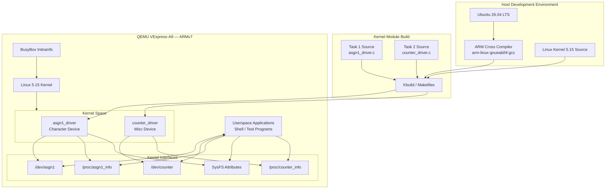
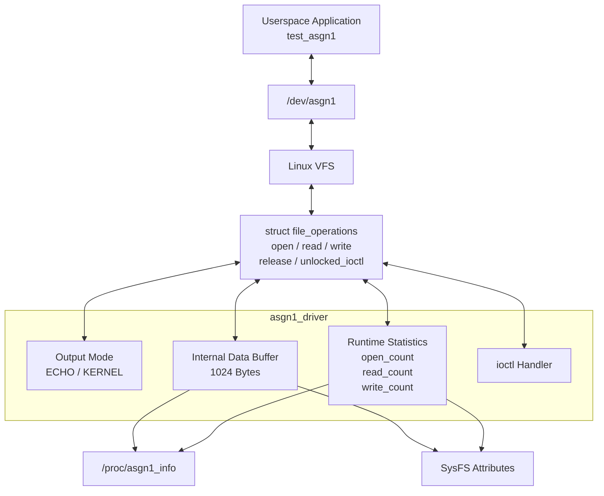
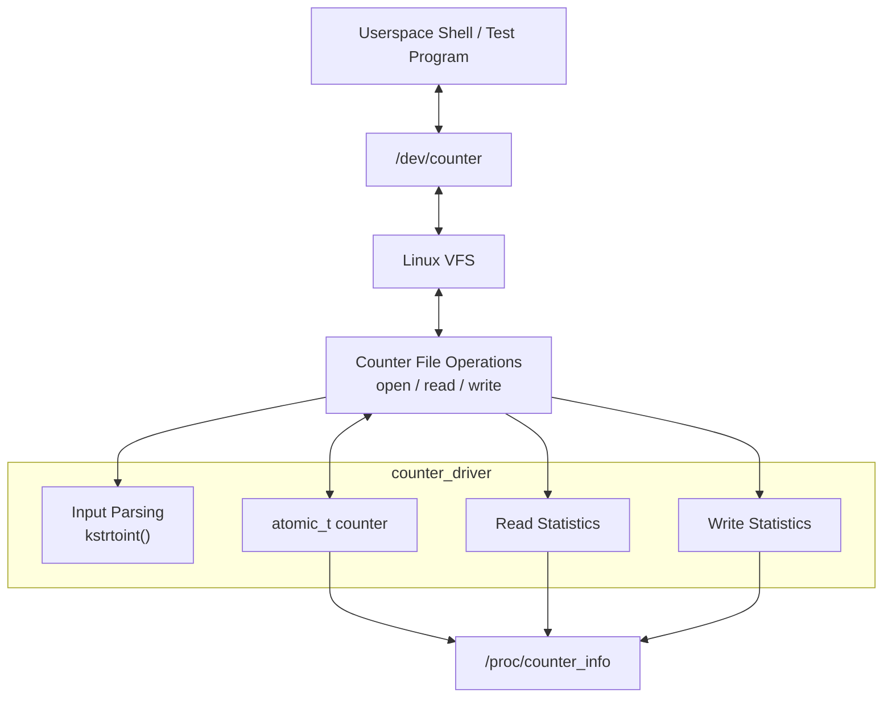
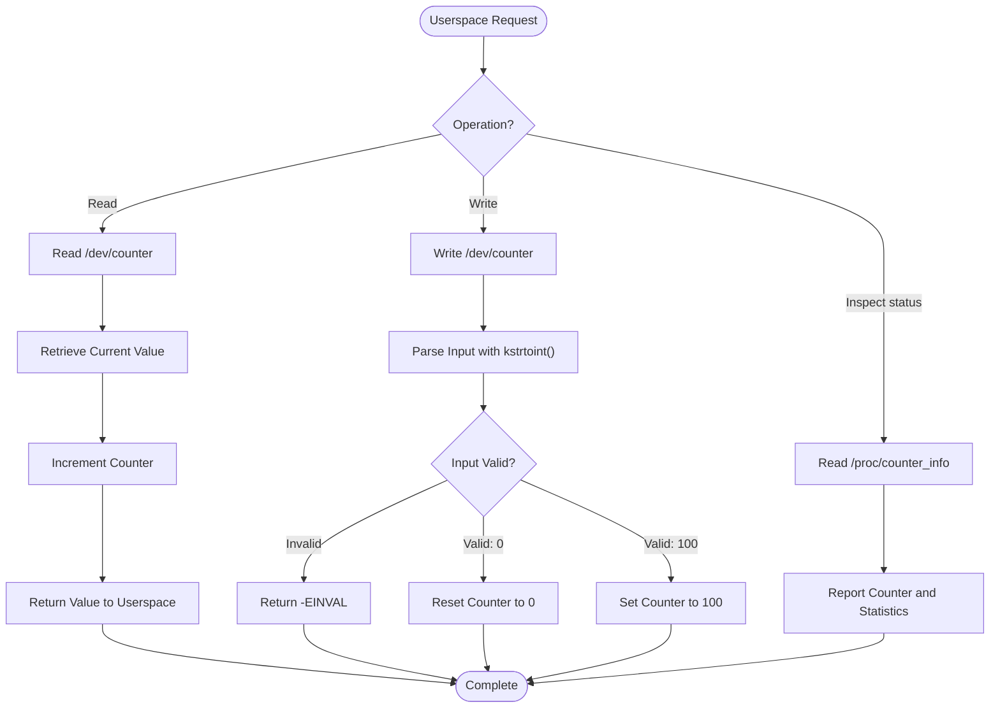
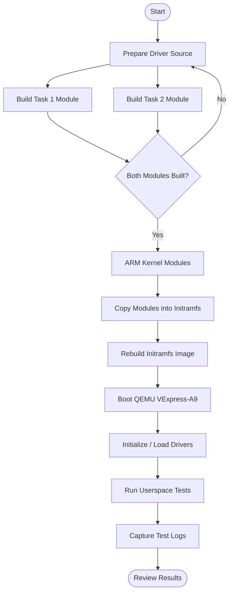
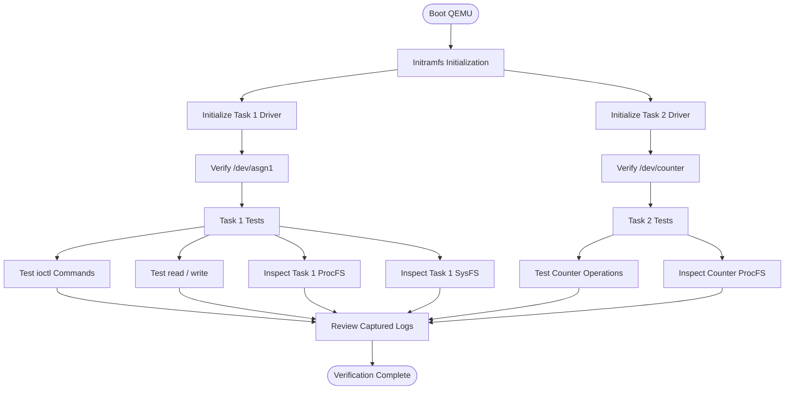

<div align="center">

# Embedded Linux Assignment 01

### Linux Kernel Character Device Driver Development

<p>
  
  
  
  
  
</p>

**Character Device · ioctl · Misc Device · ProcFS · SysFS · Atomic Operations**

A practical Linux kernel programming assignment focused on kernel modules, device interfaces, and userspace-to-kernel communication.

Developed in C, cross-compiled for ARMv7, and tested on a Linux 5.15 kernel running under QEMU VExpress-A9.

</div>

---

## Table of Contents

- [1. Project Overview](#1-project-overview)
- [2. Development Environment](#2-development-environment)
- [3. System Architecture](#3-system-architecture)
- [4. Repository Structure](#4-repository-structure)
- [5. Assignment Objectives](#5-assignment-objectives)
- [6. Task 1 — Character Device Driver](#6-task-1--character-device-driver)
- [7. Task 2 — Counter Misc Device Driver](#7-task-2--counter-misc-device-driver)
- [8. Build and Deployment Workflow](#8-build-and-deployment-workflow)
- [9. Runtime Verification Workflow](#9-runtime-verification-workflow)
- [10. Test Evidence](#10-test-evidence)
- [11. Key Linux Kernel Concepts](#11-key-linux-kernel-concepts)
- [12. Limitations and Notes](#12-limitations-and-notes)
- [13. Author](#13-author)

---

## 1. Project Overview

This repository contains the implementation of **Embedded Linux Assignment 01**, covering two independent Linux kernel modules.

### Task 1 — `asgn1_driver`

A character device driver that demonstrates:

- Character-device registration and file operations.
- Userspace-to-kernel data transfer.
- `read()`, `write()`, `open()`, and `release()` operations.
- Custom ioctl commands.
- Runtime statistics.
- ProcFS and SysFS interfaces.
- ECHO and KERNEL output modes.

### Task 2 — `counter_driver`

A miscellaneous character device that demonstrates:

- Miscellaneous device registration using `miscdevice`.
- Atomic counter management using `atomic_t`.
- Device read and write operations.
- Input conversion and validation using `kstrtoint()`.
- Read and write statistics.
- ProcFS-based runtime information.

Both drivers are implemented independently and can be built as separate kernel modules.

The project also includes test source code and recorded terminal logs for documenting runtime behavior.

---

## 2. Development Environment

| Component | Configuration |
|---|---|
| Host operating system | Ubuntu 26.04 LTS, 64-bit |
| Target architecture | ARMv7 |
| Virtual platform | QEMU VExpress-A9 |
| CPU architecture | ARM Cortex-A9 |
| Linux kernel | Linux 5.15 |
| Memory | 512 MB |
| CPU cores | 2 |
| Cross compiler | `arm-linux-gnueabihf-gcc` |
| Kernel build system | Kbuild |
| Root filesystem | BusyBox Initramfs |
| Programming language | C |
| Debugging interface | Kernel messages, ProcFS, SysFS |

> **Build environment note:** The commands in this README assume that the Linux kernel source is available at `~/embedded_lab1/kernel/linux-5.15`. Adjust `KDIR` if your kernel source is stored elsewhere.

---

## 3. System Architecture

The system consists of a host development environment, a cross-compilation stage, an ARM-based virtual target, and two independent kernel drivers.

### 3.1 High-Level Architecture



### 3.2 Userspace-to-Kernel Communication

Userspace programs access the drivers through standard Linux interfaces.


The primary communication paths are:

| Interface | Purpose |
|---|---|
| `/dev/asgn1` | Character-device data transfer and ioctl operations |
| `/dev/counter` | Counter read and write operations |
| `/proc/asgn1_info` | Task 1 runtime information |
| SysFS attributes | Task 1 driver attributes |
| `/proc/counter_info` | Task 2 counter information |

---

## 4. Repository Structure

```text
embedded-linux-assignment01/
├── task1_ioctl/
│   ├── asgn1_driver.c
│   ├── asgn1_ioctl.h
│   ├── test_asgn1.c
│   └── Makefile
│
├── task2_misc/
│   ├── counter_driver.c
│   └── Makefile
│
├── logs/
│   ├── test_asgn1_output.txt
│   ├── test_counter_output.txt
│   └── dmesg_full.txt
│
├── .gitignore
└── README.md
```

### Directory Description

| Path | Description |
|---|---|
| `task1_ioctl/` | Task 1 character-device driver and ioctl interface |
| `task1_ioctl/asgn1_driver.c` | Task 1 kernel-module implementation |
| `task1_ioctl/asgn1_ioctl.h` | Shared ioctl definitions and statistics structure |
| `task1_ioctl/test_asgn1.c` | Userspace test application |
| `task1_ioctl/Makefile` | Task 1 kernel-module build configuration |
| `task2_misc/` | Task 2 miscellaneous device driver |
| `task2_misc/counter_driver.c` | Counter driver implementation |
| `task2_misc/Makefile` | Task 2 kernel-module build configuration |
| `logs/` | Recorded terminal output and kernel messages |

The kernel source tree, generated kernel modules, and Initramfs image are part of the local development environment and are not assumed to be included in this repository.

---

## 5. Assignment Objectives

The assignment focuses on practical Linux kernel programming.

| No. | Objective | Related Technology |
|---:|---|---|
| 1 | Implement a character device driver | Character-device API |
| 2 | Implement file operations | `struct file_operations` |
| 3 | Transfer data between userspace and kernel space | `copy_to_user()`, `copy_from_user()` |
| 4 | Implement custom control commands | `ioctl()` |
| 5 | Expose driver information | ProcFS and SysFS |
| 6 | Implement a miscellaneous device | `struct miscdevice` |
| 7 | Manage a counter safely | `atomic_t` |
| 8 | Validate userspace input | `kstrtoint()` |
| 9 | Cross-compile kernel modules | ARM GCC and Kbuild |
| 10 | Test drivers in a virtual ARM environment | QEMU VExpress-A9 |

---

## 6. Task 1 — Character Device Driver

### 6.1 Driver Overview

**Module:** `asgn1_driver`

**Device node:** `/dev/asgn1`

**Device major number:** `241`

**Buffer capacity:** `1024 bytes`

Task 1 implements a character device driver that allows userspace applications to exchange data with the Linux kernel and control driver behavior through ioctl commands.

### 6.2 Driver Block Diagram



### 6.3 Supported File Operations

| Operation | Purpose |
|---|---|
| `open()` | Open the device and update the relevant state |
| `read()` | Transfer available driver data to userspace |
| `write()` | Receive data from userspace |
| `release()` | Handle device closure |
| `unlocked_ioctl()` | Process custom driver-control commands |

The driver uses kernel userspace-copy helpers to transfer data safely across the userspace/kernel-space boundary.

### 6.4 ioctl Interface

The ioctl interface is defined in `asgn1_ioctl.h`.

| Command | Description |
|---|---|
| `ASGN1_IOC_RESET_BUFFER` | Reset the driver buffer according to the implementation |
| `ASGN1_IOC_GET_STATS` | Retrieve driver statistics |
| `ASGN1_IOC_SET_MODE` | Change the driver output mode |
| `ASGN1_IOC_GET_VERSION` | Retrieve the driver version |

The statistics structure tracks information such as:

- Number of device opens.
- Number of writes.
- Number of reads.
- Buffer length.
- Last write size.

### 6.5 Output Modes

**ECHO mode**

The driver returns stored user-provided data according to its read/write implementation.

**KERNEL mode**

The driver applies the kernel-mode output behavior, including the configured `[KERNEL] ` prefix.

Example observed output:

```text
[KERNEL] Assignment 01 Task 1 test
```

### 6.6 ProcFS and SysFS

**ProcFS**

```text
/proc/asgn1_info
```

Provides runtime information about the driver.

**SysFS**

```text
/sys/class/asgn1_class/asgn1/
```

Relevant attributes include:

```text
buffer_len
open_count
last_data
student_name
student_id
```

The `student_name` and `student_id` attributes are retained as part of the implementation.

---

## 7. Task 2 — Counter Misc Device Driver

### 7.1 Driver Overview

**Module:** `counter_driver`

**Device node:** `/dev/counter`

**Device major number:** `10` (miscellaneous-device major)

Task 2 implements an independent miscellaneous character device. Unlike Task 1, it uses the Linux misc-device framework instead of registering a dedicated character-device major number.

### 7.2 Driver Block Diagram



### 7.3 Misc Device Registration

The driver uses:

```c
struct miscdevice
```

The misc-device framework handles device registration and exposes the device through the Linux device model.

The device is registered and deregistered using:

```c
misc_register()
misc_deregister()
```

### 7.4 Counter Behavior

The intended behavior is summarized below.

| Operation | Expected behavior |
|---|---|
| Read `/dev/counter` | Return the current counter value and increment the counter |
| Write `0` | Reset the counter |
| Write `100` | Set the counter to `100` |
| Write a negative value | Reject the input with `-EINVAL` |
| Write non-numeric input | Reject the input with `-EINVAL` |
| Read `/proc/counter_info` | Display the current value and operation statistics |

The implementation uses `atomic_t` for counter state and `kstrtoint()` for converting userspace input.

### 7.5 Counter Operation Workflow



### 7.6 ProcFS Interface

The driver exposes runtime information through:

```text
/proc/counter_info
```

The interface reports:

- Current counter value.
- Total read operations.
- Total write operations.

The exact counter-update and statistics semantics are determined by the driver implementation.

---

## 8. Build and Deployment Workflow

The project follows a cross-compilation workflow: source code is compiled on the Ubuntu host, then the resulting ARM kernel modules are deployed to the target root filesystem.

### 8.1 Build Workflow Diagram



### 8.2 Build Task 1

From the repository root:

```bash
cd task1_ioctl
```

Build the kernel module:

```bash
make
```

Build the userspace test application using the native compiler:

```bash
gcc -Wall -Wextra -O2 \
    test_asgn1.c \
    -o test_asgn1
```

The test application must be compiled for the architecture on which it will run. If it runs inside the ARM guest, use an appropriate ARM cross compiler and deploy the resulting binary into the target root filesystem.

### 8.3 Build Task 2

```bash
cd ../task2_misc
make
```

### 8.4 Kernel Source Configuration

The Makefiles use the local Linux kernel source tree.

The effective build configuration should match the target kernel:

```text
ARCH=arm
CROSS_COMPILE=arm-linux-gnueabihf-
```

Check the generated module architecture:

```bash
file task1_ioctl/asgn1_driver.ko
file task2_misc/counter_driver.ko
```

Both modules should be ARM relocatable objects when built for the configured ARM target.

> **Important:** The generated `.ko` files must be built against a compatible kernel build tree. A successful compilation alone does not guarantee that a module can be loaded by a different kernel.

### 8.5 Boot QEMU

The following command reflects the local development environment. Update the paths if the kernel or Initramfs is stored elsewhere.

```bash
qemu-system-arm \
    -M vexpress-a9 \
    -m 512M \
    -smp 2 \
    -kernel ~/embedded_lab1/kernel/linux-5.15/arch/arm/boot/zImage \
    -dtb ~/embedded_lab1/kernel/linux-5.15/arch/arm/boot/dts/vexpress-v2p-ca9.dtb \
    -initrd ~/embedded_asgn1/output/initramfs_asgn1.cpio.gz \
    -append "console=ttyAMA0,115200 rdinit=/sbin/init mem=512M" \
    -nographic
```

This command assumes that the kernel image, device tree blob, and Initramfs have already been built.

---

## 9. Runtime Verification Workflow

The verification process checks driver initialization, device availability, device operations, and exported kernel interfaces.



### 9.1 Task 1 Verification

Check that the module is loaded:

```bash
lsmod | grep asgn1_driver
```

Check the device node:

```bash
ls -l /dev/asgn1
```

Inspect ProcFS:

```bash
cat /proc/asgn1_info
```

Inspect SysFS:

```bash
ls /sys/class/asgn1_class/asgn1/
```

Run the userspace test application from the environment in which it was compiled:

```bash
./test_asgn1
```

The recorded test session exercises the ioctl interface and character-device read/write behavior.

### 9.2 Task 2 Verification

Check the module:

```bash
lsmod | grep counter_driver
```

Check the device node:

```bash
ls -l /dev/counter
```

Inspect the counter status:

```bash
cat /proc/counter_info
```

Test setting the counter to `100`:

```bash
printf '100' > /dev/counter
cat /proc/counter_info
```

Test resetting the counter:

```bash
printf '0' > /dev/counter
cat /proc/counter_info
```

These commands should be run inside the target environment where the driver is registered and the device node exists.

**Note:** Reading a device using `cat` can trigger multiple reads depending on the implementation. For precise counter testing, use a test program that performs a controlled number of system calls.

---

## 10. Test Evidence

The repository contains recorded terminal output in the `logs/` directory.

| Log file | Evidence |
|---|---|
| `logs/test_asgn1_output.txt` | Task 1 test session, including ioctl operations and character-device I/O |
| `logs/test_counter_output.txt` | Task 2 counter read/write behavior and ProcFS information |
| `logs/dmesg_full.txt` | Captured kernel boot messages and driver initialization messages |

### 10.1 Task 1 Observations

The recorded session includes:

- Driver version retrieval.
- ECHO and KERNEL mode operations.
- Runtime statistics retrieval.
- Buffer reset operation.
- Character-device write and read.
- Inspection of `/proc/asgn1_info`.

### 10.2 Task 2 Observations

The recorded session includes:

- Initial counter value of `0`.
- Setting the counter to `100`.
- Reading the current counter value.
- Resetting the counter to `0`.
- Inspecting operation statistics through ProcFS.

### 10.3 Kernel Initialization

The captured kernel messages include driver initialization messages for both modules, including the Task 1 major number and Task 2 miscellaneous-device registration.

These files document observed test sessions. They should not be interpreted as proof of tests that are not represented in the captured output.

---

## 11. Key Linux Kernel Concepts

| Concept | Application |
|---|---|
| Character device | Implements the Task 1 userspace interface |
| `struct file_operations` | Connects system calls to driver callbacks |
| `copy_to_user()` | Transfers kernel data to userspace |
| `copy_from_user()` | Transfers userspace data to the kernel |
| `unlocked_ioctl()` | Implements custom device-control operations |
| ProcFS | Exposes runtime information |
| SysFS | Exposes driver attributes |
| `struct miscdevice` | Registers the Task 2 miscellaneous device |
| `atomic_t` | Provides atomic counter operations |
| `kstrtoint()` | Converts text input to an integer |
| Kbuild | Builds kernel modules against the configured kernel tree |
| ARM cross-compilation | Produces modules for the ARM target |
| QEMU | Provides a virtual ARM environment for runtime testing |

---

## 12. Limitations and Notes

- This project is an educational kernel-programming assignment.
- The drivers are built for the configured Linux 5.15 ARM environment.
- Kernel modules must match the target kernel's architecture and compatible build configuration.
- Device nodes and exported interfaces are available only when the corresponding drivers have been initialized successfully.
- Runtime results depend on the implementation, kernel configuration, and test environment.
- The repository's log files represent captured test sessions rather than a guarantee of every possible edge case.
- The build commands assume the local kernel source and Initramfs paths described in this README.
- This repository documents the driver implementation and verification workflow; it does not assume that a complete kernel image or root filesystem is included.

---

## 13. Author

**Hoang Trung Hai**  
FPT University — IC Design

**Project:** Embedded Linux Assignment 01

**Topics:** Linux Kernel Development · Character Device Drivers · Embedded Systems · ARM Cross-Compilation

---

<div align="center">

**Embedded Linux Assignment 01**

*Learning Linux kernel development through practical driver implementation.*

</div>
